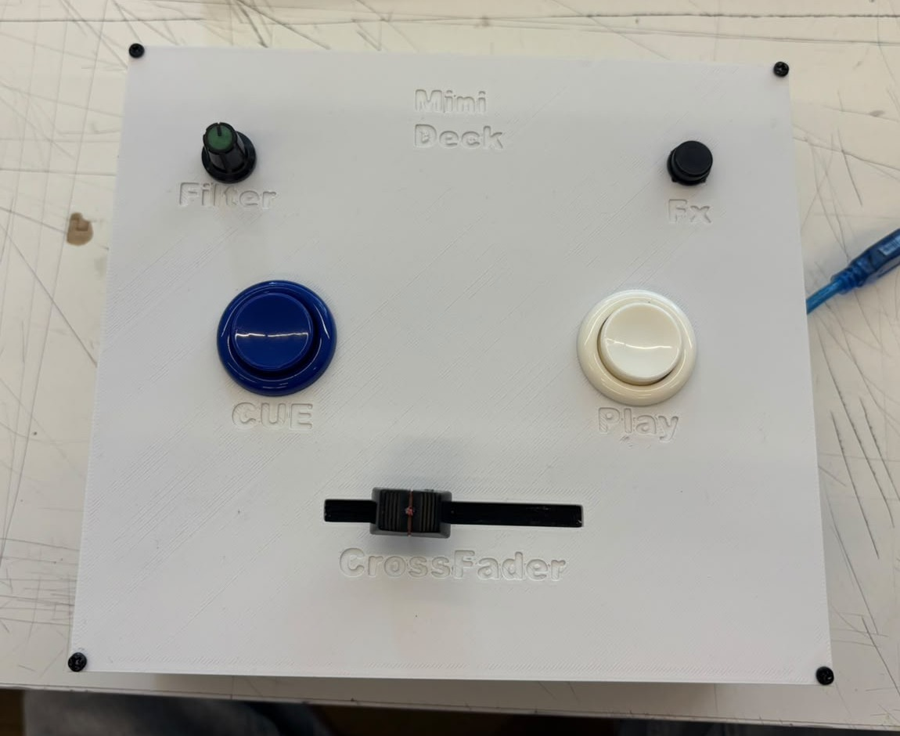
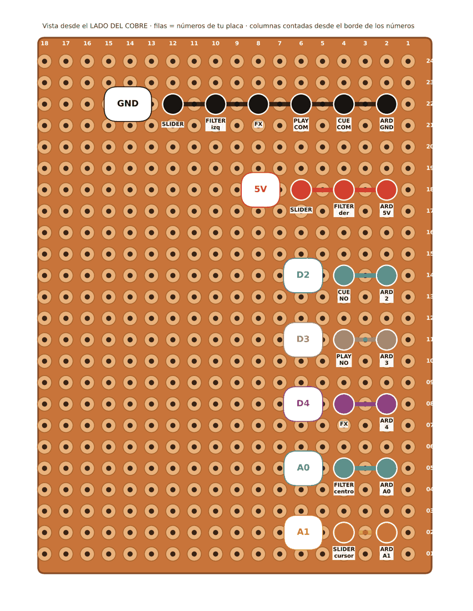
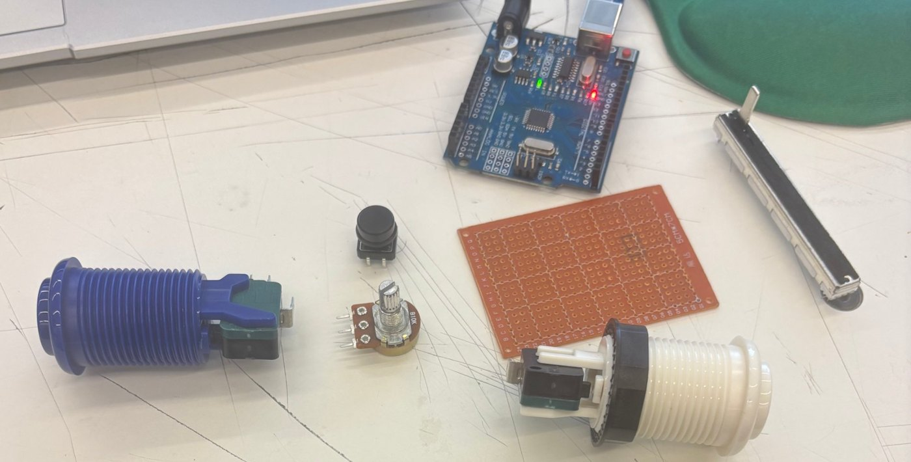
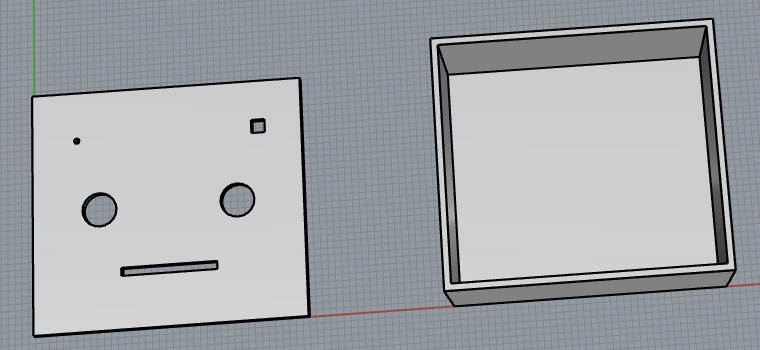
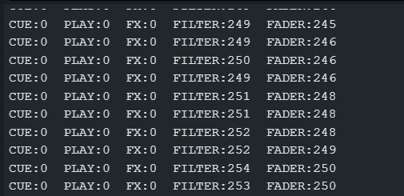
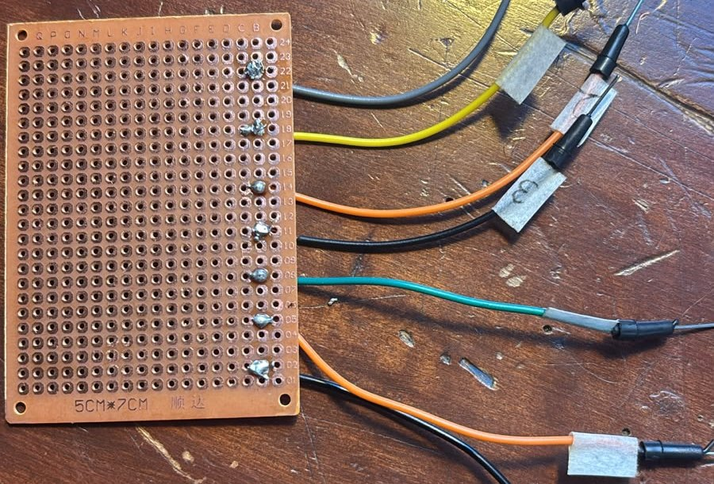
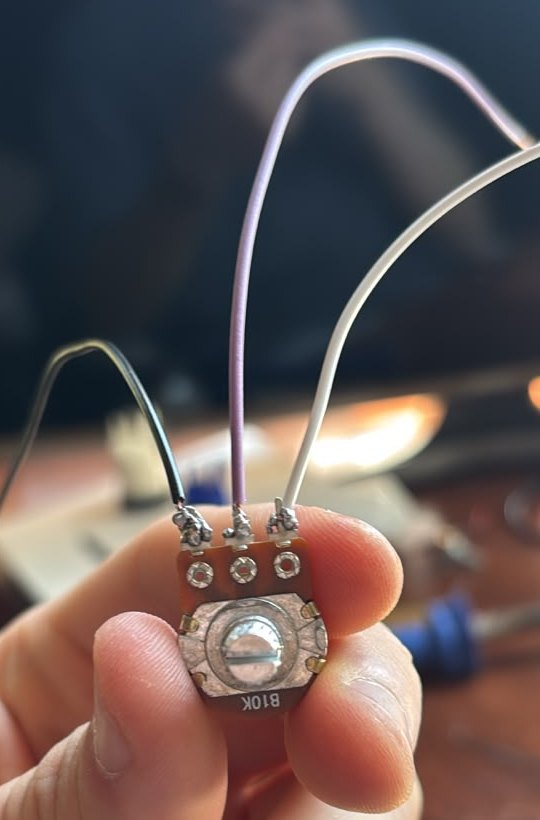
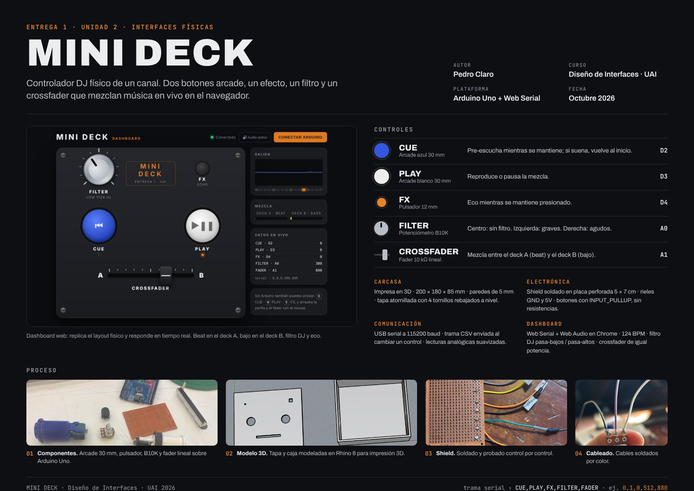

# MINI DECK

**Controlador DJ físico de un canal.** Dos botones arcade, un efecto, un filtro y un crossfader que mezclan música en vivo en el navegador.

Entrega 1 · Unidad 2: Interfaces físicas · Diseño de Interfaces · UAI
Autor: Pedro Claro · Octubre 2026



## Video

[](https://youtube.com/shorts/lWUqFrEio6M)

▶️ **Video de demostración:** https://youtube.com/shorts/lWUqFrEio6M

## Controles

| Control | Componente | Dato | Pin | Función en el dashboard |
|---|---|---|---|---|
| **CUE** | Botón arcade azul | Discreto (0/1) | D2 | Pre-escucha mientras se mantiene; si suena, vuelve al inicio y pausa |
| **PLAY** | Botón arcade blanco | Discreto (0/1) | D3 | Reproduce o pausa |
| **FX** | Pulsador 12 mm | Discreto (0/1) | D4 | Eco mientras se mantiene |
| **FILTER** | Potenciómetro B10K | Continuo (0–1023) | A0 | Filtro DJ: centro neutro, izquierda graves, derecha agudos |
| **CROSSFADER** | Fader 10 kΩ lineal | Continuo (0–1023) | A1 | Mezcla entre deck A (beat) y deck B (bajo) |

## Esquema de conexiones

Toda la electrónica está soldada en una placa perforada de 5 × 7 cm (sin protoboard). Del shield salen 7 cables etiquetados que se enchufan en el Arduino Uno, por lo que el Arduino se desmonta sin desoldar.



| Fila de la placa | Señal | Cable al Arduino | Componentes |
|---|---|---|---|
| 22 | GND | GND | CUE (COM), PLAY (COM), FX, FILTER (izq), CROSSFADER (extremo) |
| 18 | 5V | 5V | FILTER (der), CROSSFADER (extremo) |
| 14 | D2 | 2 | CUE (NO) |
| 11 | D3 | 3 | PLAY (NO) |
| 08 | D4 | 4 | FX |
| 05 | A0 | A0 | FILTER (centro) |
| 02 | A1 | A1 | CROSSFADER (cursor) |

Los botones usan `INPUT_PULLUP` (resistencia interna del Arduino), así que el circuito no lleva resistencias.

## Carcasa

- Impresa en 3D en PLA blanco, modelada en Rhino 8.
- 200 × 180 × 85 mm (caja de 80 mm + tapa de 5 mm), paredes de 5 mm.
- Tapa fijada con 4 tornillos en las esquinas, con la cabeza rebajada a nivel.
- Etiquetas modeladas en la tapa.

## Software

### Arduino (`mini_deck.ino`)

Envía por USB serial a **115200 baud** una línea por lectura:

```
CUE,PLAY,FX,FILTER,FADER
0,1,0,512,880
```

- Envía cuando cambia un valor y, además, cada 250 ms.
- Suaviza las lecturas analógicas para eliminar ruido.

### Dashboard (`dashboard/index.html`)

Página web que usa **Web Serial** para leer el Arduino y **Web Audio** para generar el sonido (beat en el deck A y bajo en el deck B, a 124 BPM).

**Cómo usarlo:**
1. Cargar `mini_deck.ino` en el Arduino con el Arduino IDE.
2. Cerrar el Monitor Serie del Arduino IDE (solo un programa puede usar el puerto a la vez).
3. Abrir `dashboard/index.html` en **Google Chrome** o **Edge**.
4. Presionar **CONECTAR ARDUINO** y elegir el puerto.

Sin Arduino también se puede probar: teclas `Q` (CUE), `W` (PLAY) y `E` (FX), y arrastrar la perilla y el fader con el mouse.

## Proceso de fabricación

| | |
|---|---|
|  **1. Componentes** |  **2. Modelo 3D en Rhino** |
|  **3. Prueba de cada control en el Monitor Serie** |  **4. Soldadura del shield** |
|  **5. Cableado de los controles** |  **6. Producto final** |

## Láminas

- [Lámina de producto (PDF)](Mini_Deck_Lamina.pdf)
- [Informe de producto, 4 páginas (PDF)](Mini_Deck_Informe.pdf)



## Estructura del repositorio

```
mini-deck-casero/
├── README.md                  este documento
├── index.html                 página del proyecto (GitHub Pages)
├── dashboard/index.html       dashboard web (Web Serial + Web Audio)
├── mini_deck.ino              código del Arduino
├── shield_mapa.png            esquema de conexiones del shield
├── Mini_Deck_Lamina.pdf/.jpg  lámina de producto
├── Mini_Deck_Informe.pdf      informe de producto
└── 01…06_*.jpg                fotos del proceso
```

Página del proyecto: https://pclarow.github.io/mini-deck-casero/
